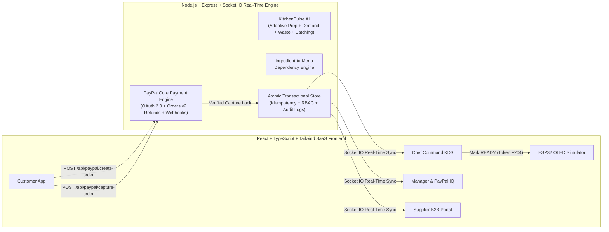

# FEEDO PAY — The Intelligent Food Commerce & Restaurant Operations Ecosystem

> **Tagline:** *Order Smart. Pay Securely. Eat Faster. Waste Less.*
>
> **Core Thesis:** *"PayPal does not simply process the payment. A verified payment initiates a coordinated chain of intelligent food-service operations."*

---

## 1. Project Overview

**FEEDO PAY** is an integrated food-service operating system connecting four operational stakeholders in real time:
1. **Customers / Students** (`student@feedo.demo`)
2. **Chefs / Kitchen Staff** (`chef@feedo.demo`)
3. **Restaurant / Canteen Managers** (`manager@feedo.demo`)
4. **Agro & Cold-Chain Suppliers** (`supplier@feedo.demo`)

Unlike conventional food-ordering websites with a decorative checkout button, FEEDO PAY orchestrates the complete operational lifecycle:

$$\text{Table Reservation} \rightarrow \text{Ingredient-Aware Menu} \rightarrow \text{PayPal Checkout} \rightarrow \text{Server Capture Verification} \rightarrow \text{Atomic Recipe Deduction} \rightarrow \text{Digital Token (F204)} \rightarrow \text{Chef KDS} \rightarrow \text{ESP32 Smart Counter} \rightarrow \text{Supplier Replenishment \& Waste Analytics}$$

---

## 2. System Architecture



---

## 3. Technology Stack

- **Frontend:** React 18, TypeScript, Vite, Tailwind CSS (Emerald, Warm Ivory, Charcoal & Gold design system), Recharts, Lucide Icons, Socket.IO Client
- **Backend:** Node.js, Express, TypeScript (`tsx`), Socket.IO Server, REST APIs
- **Payment Engine:** Official PayPal Developer Sandbox REST APIs (`/v1/oauth2/token`, `/v2/checkout/orders`, `/v2/payments/captures/{id}/refund`, `/v1/notifications/verify-webhook-signature`) + Official PayPal JavaScript SDK loader with an explicitly separated Demo Sandbox Simulation fallback when credentials are unconfigured
- **AI / Intelligence Engine:** **FEEDO INTELLIGENCE — KitchenPulse AI** (Explainable Adaptive Prep-Time Predictor, Intelligent Order Batching, Smart Queue Priority, Seeded 7-Day Demand Forecasting, and Food Waste Prevention)
- **IoT Hardware Module:** ESP32-WROOM-32D + 0.96" I2C SSD1306 OLED Display (`hardware/feedo_esp32_counter.ino`) + Interactive Browser Hardware Simulator

---

## 4. Installation & Running the Application

```bash
cd C:\Users\ramas\.gemini\antigravity\scratch\feedo-pay

# 1. Install dependencies
npm install

# 2. Run the automated verification test suite
npm test

# 3. Build frontend bundle for production verification
npm run build

# 4. Start full-stack development server (Express API on :4000 + Vite on :5173)
npm run dev
```

---

## 5. Environment Setup & PayPal Sandbox Setup

Copy `.env.example` to `.env`:

```env
PAYPAL_CLIENT_ID=your_paypal_sandbox_client_id
PAYPAL_CLIENT_SECRET=your_paypal_sandbox_client_secret
PAYPAL_BASE_URL=https://api-m.sandbox.paypal.com
PAYPAL_WEBHOOK_ID=your_paypal_webhook_id
PAYPAL_CURRENCY=USD
PORT=4000
```

- **How to obtain PayPal Sandbox Credentials:**
  1. Sign in to the [PayPal Developer Dashboard](https://developer.paypal.com/dashboard/).
  2. Navigate to **Apps & Credentials** (ensure the **Sandbox** toggle is active).
  3. Create or select an App and copy the **Client ID** and **Client Secret** into `.env` (or paste them live at runtime inside **Manager Control Center → Configure PayPal Sandbox Keys**).
- **Explicit Demo Mode Separation:** If `.env` credentials are left blank, FEEDO PAY operates in an explicitly labelled `PAYPAL_DEMO_SIMULATION` mode so judges can test the entire server-verified create/capture/refund/failure workflow without external credential setup.

---

## 6. Demo Login Credentials (Role-Based Access Control)

| Stakeholder Role | Demo Email | Demo Password | Key Capabilities |
| :--- | :--- | :--- | :--- |
| **Customer / Student** | `student@feedo.demo` | `feedo2026` | Table reservation (Table #12), ingredient-aware menu, PayPal checkout, digital token & receipt |
| **Chef / Kitchen Staff** | `chef@feedo.demo` | `feedo2026` | Real-time Kitchen Command Center, Intelligent Order Batching, prep progress, 1-click READY trigger |
| **Restaurant Manager** | `manager@feedo.demo` | `feedo2026` | PayPal Payment Intelligence, full/partial refunds, KitchenPulse AI insights, delivery verification |
| **Agro Supplier** | `supplier@feedo.demo` | `feedo2026` | Incoming low-stock replenishment orders, accept/reject, cold-chain dispatch status |

---

## 7. Core REST API Documentation

### PayPal Payment Engine
- `GET /api/paypal/config` — Returns public PayPal SDK configuration & active mode (`PAYPAL_SANDBOX` or `PAYPAL_DEMO_SIMULATION`).
- `POST /api/paypal/create-order` — Validates cart quantities, verifies recipe ingredient stock via the Dependency Engine, computes total on the server, creates a `PENDING_PAYMENT` order, and calls PayPal Orders v2 API.
- `POST /api/paypal/capture-order` — Idempotently captures an approved PayPal order. Only upon verified `COMPLETED` capture does it atomically deduct recipe ingredients, generate sequential token `F204`, and dispatch to the Chef KDS.
- `POST /api/paypal/cancel-order` — Safely cancels a pending checkout without deducting inventory.
- `POST /api/paypal/webhook` — Verifies PayPal webhook cryptographic headers and reconciles capture events.
- `POST /api/paypal/refund` — *(Manager RBAC)* Initiates full or partial capture refunds via PayPal Payments v2 Refund API.

### Operations, KitchenPulse AI & IoT Counter
- `GET /api/state` — Full real-time ecosystem snapshot.
- `POST /api/tables/reserve` — Reserves a dining table (Tables 1–16).
- `POST /api/kitchen/orders/:id/status` — *(Chef/Manager RBAC)* Transitions verified orders through `ACCEPTED` → `PREPARING` → `READY_FOR_COLLECTION` → `COMPLETED`.
- `POST /api/kitchen/report-shortage` — *(Chef/Manager RBAC)* Reports station ingredient shortage and auto-disables dependent menu items.
- `POST /api/manager/supplier-requests/:id/verify-delivery` — *(Manager RBAC)* Verifies physical delivery at dock, increments stock, and restores dependent menu items.
- `POST /api/iot/heartbeat` — Authenticated ESP32 Smart Counter heartbeat & token state sync.
- `POST /api/demo/reset` — Resets the ecosystem to the clean demonstration seed so the next order generates Token `F204`.

---

## 8. ESP32 Smart Counter Hardware Integration Instructions

1. Open `hardware/feedo_esp32_counter.ino` in Arduino IDE or PlatformIO.
2. Wire an **SSD1306 0.96" I2C OLED** (`SDA -> GPIO21`, `SCL -> GPIO22`), an **Emerald Status LED** (`GPIO25`), and an **Active Piezo Buzzer** (`GPIO26`) to an **ESP32-WROOM-32D**.
3. Update `WIFI_SSID`, `WIFI_PASS`, and `SERVER_BASE_URL` in the sketch and flash to the ESP32.
4. Or use the built-in **IoT Smart Counter Browser Simulator** inside the web app to demonstrate `F204` token display, LED pulsing, and duplicate alert protection without physical hardware.
